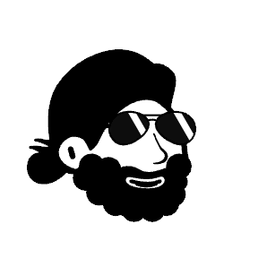
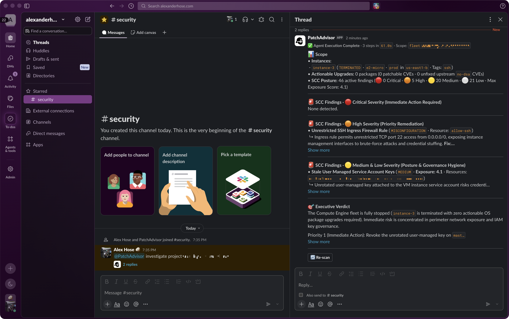

<p align="center">
  
</p>

<h1 align="center">PatchAdvisor</h1>

<p align="center">
  <strong>Autonomous GCP Vulnerability Triage & Safe Remediation Agent</strong><br>
  Correlates OS Config with SCC v2 attack paths · Canary-first patch execution · Vertex AI Agent Engine
</p>

<p align="center">
  
  
  
</p>

<p align="center">
  <a href="#setup--deployment-guide"><strong>Agent Deployment »</strong></a> &nbsp;|&nbsp;
  <a href="slack_gateway/README.md"><strong>Slack Gateway Setup »</strong></a> &nbsp;|&nbsp;
  <a href="AGENTS.md"><strong>Engineering Spec (AGENTS.md)</strong></a>
</p>

---

PatchAdvisor is a multi-agent cloud security system built on Google's **Agent Development Kit (ADK)** and hosted on **Vertex AI Agent Engine**.

Raw CVE dumps waste engineering time. PatchAdvisor correlates OS Config vulnerability reports with active **Security Command Center (SCC) v2** attack paths and threat intelligence, groups updates by operational blast radius, patches canary VMs first, verifies serial console and Cloud Logging daemon health, rolls back failed updates from boot disk snapshots, and records empirical package behavior in **Vertex AI Memory Bank**.

<p align="center">
  
</p>

---

## Agent Architecture & Capabilities

* **`root_agent` ([`remediation_agent/agent.py`](remediation_agent/agent.py)):** Routes read-only discovery to `investigator_agent` and confirmed write operations to `safe_remediation_pipeline`, persisting operational lessons to Vertex AI Memory Bank.
* **`investigator_agent` ([`remediation_agent/sub_agents/investigator/`](remediation_agent/sub_agents/investigator)):** Resolves accessible GCP projects and organizations (`resourcemanager_v3`), inspects Compute Engine VMs and OS Config vulnerability reports (`osconfig_v1`), correlates SCC v2 findings, exploitability intelligence, and attack paths (`securitycenter_v2`), and inspects VPC firewall rules and system logs (`compute_v1`, `logging_v2`).
* **`safe_remediation_pipeline` ([`remediator_agent`](remediation_agent/sub_agents/remediator) + [`validator_agent`](remediation_agent/sub_agents/validator)):** Executes confirmation-gated canary-first OS patching, pre-patch boot disk snapshotting and rollback, VPC firewall containment, VM metadata hardening, and post-patch verification.

---

## Setup & Deployment Guide

### Step 1: Enable Required GCP APIs

Enable the required APIs in your host project:

```bash
gcloud services enable \
    aiplatform.googleapis.com \
    cloudresourcemanager.googleapis.com \
    compute.googleapis.com \
    osconfig.googleapis.com \
    securitycenter.googleapis.com \
    cloudtrace.googleapis.com \
    telemetry.googleapis.com \
    logging.googleapis.com \
    --project=<YOUR_PROJECT_ID>
```

---

### Step 2: Deploy Vertex AI Agent Engine

```bash
# 1. Install ADK dependencies into a virtualenv
python3 -m venv .venv
source .venv/bin/activate
pip install -r remediation_agent/requirements.txt

# 2. Deploy the agent package
adk deploy agent_engine remediation_agent \
    --project=<YOUR_PROJECT_ID> \
    --region=us-central1 \
    --display_name=patchadvisor-agent
```

Copy the deployed Reasoning Engine resource name from the command output:
```text
projects/<YOUR_PROJECT_ID>/locations/<REGION>/reasoningEngines/<REASONING_ENGINE_ID>
```

> [!TIP]
> To update existing agent code in place without generating a new resource ID, append:
> `--agent_engine_id=<REASONING_ENGINE_ID>`

---

## Optional: Slack Operator Gateway (`slack_gateway/`)

To connect your deployed Vertex AI Agent Engine to Slack with per-user 3-legged Google OAuth 2.0 + PKCE and 1-click Block Kit confirmation buttons, follow the [**Slack Gateway Setup & Usage Guide (`slack_gateway/README.md`)**](slack_gateway/README.md).

---

## License

This project is licensed under the MIT License. See the [LICENSE](LICENSE) file for details.
