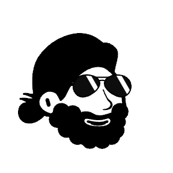
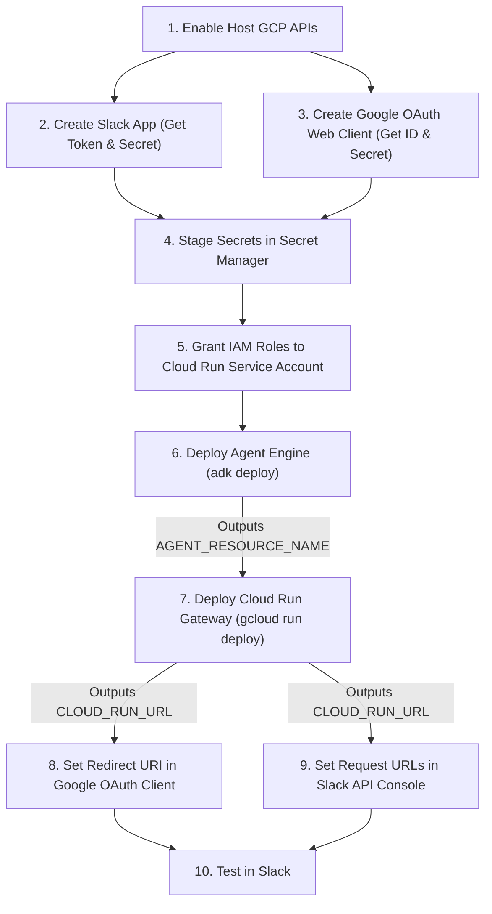

<p align="center">
  
</p>

<h1 align="center">PatchAdvisor</h1>

<p align="center">
  <strong>Autonomous GCP Vulnerability Triage & Safe Remediation Agent</strong><br>
  Correlates OS Config with SCC v2 attack paths · Canary-first patch execution · Interactive Slack operator
</p>

<p align="center">
  
  
  
  
  
  
</p>

<p align="center">
  <a href="#setup--deployment-guide"><strong>Deployment Guide »</strong></a> &nbsp;|&nbsp;
  <a href="#usage-in-slack"><strong>Usage in Slack</strong></a> &nbsp;|&nbsp;
  <a href="AGENTS.md"><strong>Engineering Spec (AGENTS.md)</strong></a>
</p>

---

PatchAdvisor is a multi-agent cloud security system built on Google's **Agent Development Kit (ADK)**, hosted on **Vertex AI Agent Engine**, and operated from **Slack** through a lightweight **Cloud Run** gateway.

Raw CVE dumps waste engineering time. PatchAdvisor correlates OS Config vulnerability reports with active **Security Command Center (SCC)** attack paths, groups updates by operational blast radius, patches canary VMs first, verifies serial console and systemd health, rolls back failed updates from boot disk snapshots, and records empirical package behavior in **Vertex AI Memory Bank**.

Every GCP API call runs under the Slack operator's own Google Cloud identity via 3-legged OAuth 2.0 + PKCE. No shared service account god-mode.

---

## Setup & Deployment Guide

Follow this sequence strictly. Each step outputs values required by the step after it.



---

### Step 1: Enable Required APIs

Enable the required GCP APIs in your host project:

```bash
gcloud services enable \
    aiplatform.googleapis.com \
    compute.googleapis.com \
    osconfig.googleapis.com \
    securitycenter.googleapis.com \
    cloudtrace.googleapis.com \
    telemetry.googleapis.com \
    logging.googleapis.com \
    run.googleapis.com \
    secretmanager.googleapis.com \
    --project=<YOUR_PROJECT_ID>
```

---

### Step 2: Create the Slack App

1. Navigate to the [Slack API Console](https://api.slack.com/apps) and click **Create New App > From an app manifest**.
2. Select your workspace and paste the contents of [`slack_manifest.yaml`](slack_manifest.yaml). Leave the webhook URLs blank for now.
3. Under **Basic Information**, note the **Signing Secret**.
4. Under **OAuth & Permissions**, note the **Bot User OAuth Token** (`xoxb-...`).

---

### Step 3: Create the Google OAuth 2.0 Web Client

1. Open **APIs & Services > OAuth consent screen** in the Google Cloud Console. Set the User Type to **Internal** so Google Workspace users skip unverified-app warnings for the `cloud-platform` scope.
2. Open **APIs & Services > Credentials** and click **Create Credentials > OAuth client ID**.
3. Choose **Web application**. Leave Authorized redirect URIs empty for now. Cloud Run will provide this URL in Step 7.
4. Note your **Client ID** and **Client Secret**.

---

### Step 4: Stage Secrets in Secret Manager

Store the four credentials in Secret Manager:

```bash
PROJECT="<YOUR_PROJECT_ID>"

printf "%s" "<YOUR_SLACK_BOT_TOKEN>" | gcloud secrets create SLACK_BOT_TOKEN --data-file=- --project="$PROJECT"
printf "%s" "<YOUR_SLACK_SIGNING_SECRET>" | gcloud secrets create SLACK_SIGNING_SECRET --data-file=- --project="$PROJECT"
printf "%s" "<YOUR_GOOGLE_CLIENT_ID>" | gcloud secrets create GOOGLE_OAUTH_CLIENT_ID --data-file=- --project="$PROJECT"
printf "%s" "<YOUR_GOOGLE_CLIENT_SECRET>" | gcloud secrets create GOOGLE_OAUTH_CLIENT_SECRET --data-file=- --project="$PROJECT"
```

---

### Step 5: Create a Dedicated Service Account and Grant IAM Permissions

Because GCP tools run under each operator's personal OAuth token via `temp:gcp_access_token`, the Cloud Run gateway needs zero access to Compute Engine, OS Config, or Security Command Center. Create a dedicated least-privilege service account scoped solely to Secret Manager reads and Agent Engine invocation:

```bash
PROJECT="<YOUR_PROJECT_ID>"
SA_NAME="patchadvisor-gateway"

# 1. Create the dedicated gateway service account
gcloud iam service-accounts create "$SA_NAME" \
    --display-name="PatchAdvisor Slack Gateway" \
    --project="$PROJECT"

SA_EMAIL="${SA_NAME}@${PROJECT}.iam.gserviceaccount.com"

# 2. Allow gateway to invoke Vertex AI Agent Engine
gcloud projects add-iam-policy-binding "$PROJECT" \
    --member="serviceAccount:$SA_EMAIL" \
    --role="roles/aiplatform.user"

# 3. Allow gateway to read only the 4 application secrets
for SECRET in SLACK_BOT_TOKEN SLACK_SIGNING_SECRET GOOGLE_OAUTH_CLIENT_ID GOOGLE_OAUTH_CLIENT_SECRET; do
  gcloud secrets add-iam-policy-binding "$SECRET" \
      --member="serviceAccount:$SA_EMAIL" \
      --role="roles/secretmanager.secretAccessor" \
      --project="$PROJECT"
done
```

---

### Step 6: Deploy Vertex AI Agent Engine

Agent Engine must be deployed before Cloud Run so you have its resource ID for gateway configuration.

```bash
# 1. Install ADK dependencies into a virtualenv
python3 -m venv .venv
source .venv/bin/activate
pip install -r remediation_agent/requirements.txt

# 2. Deploy the agent package
adk deploy agent_engine remediation_agent \
    --project=<YOUR_PROJECT_ID> \
    --region=us-central1 \
    --display_name=patchadvisor-agent
```

Copy the deployed Reasoning Engine resource name from the command output. Format:
```text
projects/<YOUR_PROJECT_ID>/locations/<REGION>/reasoningEngines/<REASONING_ENGINE_ID>
```

> [!TIP]
> To update existing agent code in place without generating a new resource ID, append:
> `--agent_engine_id=<REASONING_ENGINE_ID>`

---

### Step 7: Deploy the Slack Gateway to Cloud Run

Deploy `server.py` and pass the `AGENT_RESOURCE_NAME` from Step 6. Pin `--max-instances=1` so in-memory PKCE state and the user token cache remain on a single container instance:

```bash
gcloud run deploy patchadvisor-agent \
    --source . \
    --region us-central1 \
    --timeout=600 \
    --max-instances=1 \
    --service-account="patchadvisor-gateway@<YOUR_PROJECT_ID>.iam.gserviceaccount.com" \
    --set-env-vars AGENT_RESOURCE_NAME="projects/<YOUR_PROJECT_ID>/locations/<REGION>/reasoningEngines/<REASONING_ENGINE_ID>" \
    --set-secrets SLACK_BOT_TOKEN=SLACK_BOT_TOKEN:latest,SLACK_SIGNING_SECRET=SLACK_SIGNING_SECRET:latest,GOOGLE_OAUTH_CLIENT_ID=GOOGLE_OAUTH_CLIENT_ID:latest,GOOGLE_OAUTH_CLIENT_SECRET=GOOGLE_OAUTH_CLIENT_SECRET:latest \
    --allow-unauthenticated \
    --project <YOUR_PROJECT_ID>
```

Copy the Service URLs from Cloud Run Endpoints. Format:
```text
https://patchadvisor-agent-<HASH>-uc.a.run.app/auth/google/callback
https://patchadvisor-agent-<HASH>.<REGION>.run.app/auth/google/callback
```

---

### Step 8: Complete the Google OAuth Redirect Handshake

1. Return to **APIs & Services > Credentials** in the Google Cloud Console.
2. Edit your **OAuth 2.0 Web Client**.
3. Under **Authorized redirect URIs**, add both of your Cloud Run callback URLs:
   ```text
   https://patchadvisor-agent-<HASH>-uc.a.run.app/auth/google/callback
   https://patchadvisor-agent-<HASH>.<REGION>.run.app/auth/google/callback
   ```
4. Click **Save**.

---

### Step 9: Configure Slack Webhook URLs & Install

1. Return to the [Slack API Console](https://api.slack.com/apps) and select your app.
2. Under **Event Subscriptions**:
   * Toggle **Enable Events** to **On**.
   * Set **Request URL** to: `https://<YOUR_CLOUD_RUN_URL>/slack/events` (Slack will verify the URL challenge immediately).
3. Under **Interactivity & Shortcuts**:
   * Toggle **Interactivity** to **On**.
   * Set **Request URL** to: `https://<YOUR_CLOUD_RUN_URL>/slack/events`
4. Under **Install App**, click **Install to Workspace** (or **Reinstall**).
5. Open your Slack channel and invite the bot:
   ```text
   /invite @PatchAdvisor
   ```

---

## Usage in Slack

### 1. Authenticate on First Request
When you mention `@PatchAdvisor` or click an action button without an active token, the gateway posts an ephemeral **🔑 Sign in with Google Cloud** button visible only to you. After you approve the Google OAuth prompt, your pending Slack request starts automatically and your token stays valid for 1 hour.

### 2. Investigate Fleet & SCC v2 Posture
Mention `@PatchAdvisor` to triage a project fleet, a single VM, or organization-wide Security Command Center findings:

```text
@PatchAdvisor investigate project <YOUR_PROJECT_ID>
@PatchAdvisor investigate instance-cis in project <YOUR_PROJECT_ID> and zone us-central1-c
@PatchAdvisor check scc findings in project <YOUR_PROJECT_ID>
@PatchAdvisor check scc findings in org <YOUR_ORG_ID>
```

### 3. Remediate & Verify via 1-Click Thread Actions
Triage and remediation reports attach context-aware buttons bound to the active Slack thread:

* **🟢 Patch Tier 1 / 🟡 Patch Tier 2:** Creates a pre-patch boot disk snapshot and runs an OS Config patch job (`reboot_policy=NEVER`) on the canary VM first, verifies health, and promotes verified packages to production.
* **🔴 Approve Prod Reboot:** Snapshots the boot disk and executes Tier 3 or reboot-required updates with `reboot_policy=REBOOT_IF_NEEDED`, followed by post-reboot serial console verification.
* **🔄 Re-scan:** Re-runs discovery against the active target in the current thread.
* **⏪ Rollback:** Stops the target VM, creates a restored boot disk from the latest pre-patch snapshot, swaps the boot disk, and restarts the instance.

---

## License

This project is licensed under the MIT License. See the [LICENSE](LICENSE) file for details.