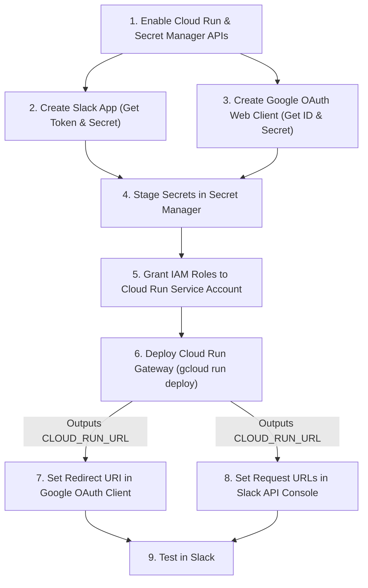

# PatchAdvisor Slack Gateway (`slack_gateway/`)

This directory contains the optional **Cloud Run Slack Gateway** ([`server.py`](server.py)) that connects Slack to a deployed PatchAdvisor **Vertex AI Agent Engine** instance using per-user 3-legged Google OAuth 2.0 + PKCE and interactive Block Kit confirmation buttons.

> **Prerequisite:** Deploy the core agent in the repository root first ([`../README.md`](../README.md)) and note your `AGENT_RESOURCE_NAME` (`projects/<PROJECT_ID>/locations/<REGION>/reasoningEngines/<REASONING_ENGINE_ID>`).

---

## Setup & Deployment Guide

Follow this sequence strictly. Each step outputs values required by the step after it.



---

### Step 1: Enable Gateway GCP APIs

```bash
gcloud services enable \
    run.googleapis.com \
    secretmanager.googleapis.com \
    --project=<YOUR_PROJECT_ID>
```

---

### Step 2: Create the Slack App

1. Navigate to the [Slack API Console](https://api.slack.com/apps) and click **Create New App > From an app manifest**.
2. Select your workspace and paste the contents of [`slack_manifest.yaml`](slack_manifest.yaml). Leave the webhook URLs blank for now.
3. Under **Basic Information**, note the **Signing Secret**.
4. Under **OAuth & Permissions**, note the **Bot User OAuth Token** (`xoxb-...`).

---

### Step 3: Create the Google OAuth 2.0 Web Client

1. Open **APIs & Services > OAuth consent screen** in the Google Cloud Console. Set the User Type to **Internal** so Google Workspace users skip unverified-app warnings for the `cloud-platform` scope.
2. Open **APIs & Services > Credentials** and click **Create Credentials > OAuth client ID**.
3. Choose **Web application**. Leave Authorized redirect URIs empty for now. Cloud Run will provide this URL in Step 6.
4. Note your **Client ID** and **Client Secret**.

---

### Step 4: Stage Secrets in Secret Manager

Store the four credentials in Secret Manager:

```bash
PROJECT="<YOUR_PROJECT_ID>"

printf "%s" "<YOUR_SLACK_BOT_TOKEN>" | gcloud secrets create SLACK_BOT_TOKEN --data-file=- --project="$PROJECT"
printf "%s" "<YOUR_SLACK_SIGNING_SECRET>" | gcloud secrets create SLACK_SIGNING_SECRET --data-file=- --project="$PROJECT"
printf "%s" "<YOUR_GOOGLE_CLIENT_ID>" | gcloud secrets create GOOGLE_OAUTH_CLIENT_ID --data-file=- --project="$PROJECT"
printf "%s" "<YOUR_GOOGLE_CLIENT_SECRET>" | gcloud secrets create GOOGLE_OAUTH_CLIENT_SECRET --data-file=- --project="$PROJECT"
```

---

### Step 5: Create a Dedicated Service Account and Grant IAM Permissions

Because GCP tools run under each operator's personal OAuth token via `temp:gcp_access_token`, the Cloud Run gateway needs zero access to Compute Engine, OS Config, or Security Command Center. Create a dedicated least-privilege service account scoped solely to Secret Manager reads and Agent Engine invocation:

```bash
PROJECT="<YOUR_PROJECT_ID>"
SA_NAME="patchadvisor-gateway"

gcloud iam service-accounts create "$SA_NAME" \
    --display-name="PatchAdvisor Slack Gateway" \
    --project="$PROJECT"

SA_EMAIL="${SA_NAME}@${PROJECT}.iam.gserviceaccount.com"

gcloud projects add-iam-policy-binding "$PROJECT" \
    --member="serviceAccount:$SA_EMAIL" \
    --role="roles/aiplatform.user"

for SECRET in SLACK_BOT_TOKEN SLACK_SIGNING_SECRET GOOGLE_OAUTH_CLIENT_ID GOOGLE_OAUTH_CLIENT_SECRET; do
  gcloud secrets add-iam-policy-binding "$SECRET" \
      --member="serviceAccount:$SA_EMAIL" \
      --role="roles/secretmanager.secretAccessor" \
      --project="$PROJECT"
done
```

---

### Step 6: Deploy the Slack Gateway to Cloud Run

Deploy from the `slack_gateway` directory and pass the `AGENT_RESOURCE_NAME` from your Agent Engine deployment. Pin `--max-instances=1` so in-memory PKCE state and the user token cache remain on a single container instance:

```bash
gcloud run deploy patchadvisor-agent \
    --source slack_gateway \
    --region us-central1 \
    --timeout=600 \
    --max-instances=1 \
    --service-account="patchadvisor-gateway@<YOUR_PROJECT_ID>.iam.gserviceaccount.com" \
    --set-env-vars AGENT_RESOURCE_NAME="projects/<YOUR_PROJECT_ID>/locations/<REGION>/reasoningEngines/<REASONING_ENGINE_ID>" \
    --set-secrets SLACK_BOT_TOKEN=SLACK_BOT_TOKEN:latest,SLACK_SIGNING_SECRET=SLACK_SIGNING_SECRET:latest,GOOGLE_OAUTH_CLIENT_ID=GOOGLE_OAUTH_CLIENT_ID:latest,GOOGLE_OAUTH_CLIENT_SECRET=GOOGLE_OAUTH_CLIENT_SECRET:latest \
    --allow-unauthenticated \
    --project <YOUR_PROJECT_ID>
```

Copy the Service URLs from Cloud Run Endpoints:
```text
https://patchadvisor-agent-<HASH>-uc.a.run.app/auth/google/callback
https://patchadvisor-agent-<HASH>.<REGION>.run.app/auth/google/callback
```

---

### Step 7: Complete the Google OAuth Redirect Handshake

1. Return to **APIs & Services > Credentials** in the Google Cloud Console.
2. Edit your **OAuth 2.0 Web Client**.
3. Under **Authorized redirect URIs**, add both of your Cloud Run callback URLs:
   ```text
   https://patchadvisor-agent-<HASH>-uc.a.run.app/auth/google/callback
   https://patchadvisor-agent-<HASH>.<REGION>.run.app/auth/google/callback
   ```
4. Click **Save**.

---

### Step 8: Configure Slack Webhook URLs & Install

1. Return to the [Slack API Console](https://api.slack.com/apps) and select your app.
2. Under **Event Subscriptions**:
   * Toggle **Enable Events** to **On**.
   * Set **Request URL** to: `https://<YOUR_CLOUD_RUN_URL>/slack/events`
3. Under **Interactivity & Shortcuts**:
   * Toggle **Interactivity** to **On**.
   * Set **Request URL** to: `https://<YOUR_CLOUD_RUN_URL>/slack/events`
4. Under **Install App**, click **Install to Workspace** (or **Reinstall**).
5. Open your Slack channel and invite the bot:
   ```text
   /invite @PatchAdvisor
   ```

---

## Usage in Slack

### 1. Authenticate on First Request
When you mention `@PatchAdvisor` or click an action button without an active token, the gateway posts an ephemeral **🔑 Sign in with Google Cloud** button visible only to you. After you approve the Google OAuth prompt, your pending Slack request starts automatically and your token stays valid for 1 hour.

### 2. Investigate Fleet & SCC v2 Posture
Mention `@PatchAdvisor` to triage a project fleet, a single VM, or organization-wide Security Command Center findings:

```text
@PatchAdvisor show me all critical issues in project <YOUR_PROJECT_ID>
@PatchAdvisor investigate instance-cis in project <YOUR_PROJECT_ID> and zone us-central1-c
@PatchAdvisor check scc findings in our org
```

### 3. Remediate & Verify via 1-Click Thread Actions
Triage and remediation reports attach context-aware confirmation buttons bound to the active Slack thread:

* **🟢 Patch Tier 1 / 🟡 Patch Tier 2:** Creates a pre-patch boot disk snapshot and runs an OS Config patch job (`reboot_policy=NEVER`) on the target/canary VM, followed by runtime and Cloud Logging verification.
* **🚀 Promote to Prod:** Promotes verified canary packages to production VMs (`reboot_policy=NEVER`) after taking a boot disk snapshot.
* **🔴 Approve Prod Reboot:** Snapshots the boot disk and executes Tier 3 or reboot-required updates with `reboot_policy=REBOOT_IF_NEEDED`.
* **🛡️ Apply Posture Fix:** Applies the confirmed VPC firewall restriction or VM metadata hardening fix.
* **🔄 Re-scan:** Re-runs discovery against the active target in the current thread.
* **⏪ Rollback:** Builds a restored boot disk from the latest pre-patch snapshot, stops the target VM, swaps the boot disk, and restarts the instance.

